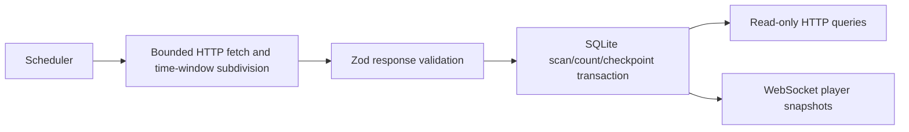

# Booth scan tracking service

A TypeScript backend that imports event-booth scans, stores deduplicated counts in SQLite, and sends player snapshots over WebSocket. It is an integration prototype for an EventsCloud-style scan endpoint, not a verified production event platform.



## Run deliberately

Use Node.js 22. Install from the lock file, inspect the environment example, and configure your own authorized provider token:

```sh
npm ci
cp .env.example .env
npm run build
npm start
```

Set `API_TOKEN`, `API_URL`, and `EVENT_START_DATE` for your permitted event. `DB_PATH` defaults to a local SQLite file; the database schema is initialized at startup. The server binds to `127.0.0.1:3000`. **Starting the server immediately polls the configured provider**, then follows `POLL_INTERVAL_CRON` (default every five minutes). No live provider or event account was accessed during this review.

Native `better-sqlite3` installation is required for the real server. The review installed dependencies with scripts disabled and did not build or load that native driver. Do not infer end-to-end SQLite verification from the tests below.

## Read API

| Route | Result |
| --- | --- |
| `GET /health` | Liveness response; not a provider freshness check |
| `GET /players` | All known badge counts |
| `GET /players/top`, `/players/bottom` | Maximum/minimum count, or 404 when empty |
| `GET /players/:badgeId` | Badge count and up to 1,000 matching scan records |
| `GET /scans` | Filtered scans, default 50, maximum 500; offset pagination |

Scan filters are `badgeId` (exact), `boothName` (partial), and `scanDate` (prefix). Results use an envelope with `success`, `data`, and `error`. A synthetic example is:

```json
{"success":true,"data":{"scans":[{"badgeId":"demo-badge-001","boothName":"Demo booth","scanDate":"2026-02-04T10:00:00"}],"total":1,"limit":50,"offset":0},"error":null}
```

WebSocket clients receive an initial snapshot and count updates after batches. There is no UI or screenshot to capture. The original README's unwrapped responses did not match the implementation; this example does.

## Import behavior and limits

The provider request uses exclusive `scanDateGT` / `scanDateLT` bounds and a JSON token body. Responses at the 1,000-record cap trigger recursive time-window subdivision. Millisecond precision and a one-millisecond overlap at split boundaries preserve exact-boundary rows. Restart polling replays the checkpoint millisecond, relying on the database uniqueness constraint to ignore duplicates. HTTP redirects are disabled and responses are limited to 8 MiB; retry logs omit raw transport errors that might carry credentials.

Each batch atomically inserts scans, increments player counts, and saves its maximum timestamp. Deduplication remains `(badgeId, scanDate)`: two different booths for the same badge at the same instant collapse into one record. Booth names are read only from the first custom-fields object. Provider timestamp timezone, precision, truncation rules, ordering, late-arrival behavior, and real request contract are not independently verified. At a saturated indivisible timestamp the importer fails instead of claiming completeness. These constraints prevent a blanket “no scans missed” guarantee.

## Verification and deployment gaps

```sh
npm test
npm run build
```

Eleven Vitest tests and TypeScript compilation pass. Tests mock HTTP calls and include a synthetic 1,001-record response with an exact split-boundary record, plus API error handling. No provider calls, native SQLite integration, cron run, or live WebSocket session was performed.

HTTP queries and WebSocket snapshots are currently unauthenticated and can disclose badge visit histories. Keep this local until event access rules, retention, and an authenticated deployment boundary are defined. Player snapshots are unbounded; graceful shutdown does not fully drain active sockets and polling work. Scaling needs measured event volumes and single-writer/multi-worker design rather than a production-grade label.

Committed SQLite WAL/SHM sidecars were removed from reachable history and ignored. README badge identifiers were replaced by obvious synthetic examples. Whether the original files represented real event data remains an owner decision; deleting Git references cannot revoke copies already downloaded.
